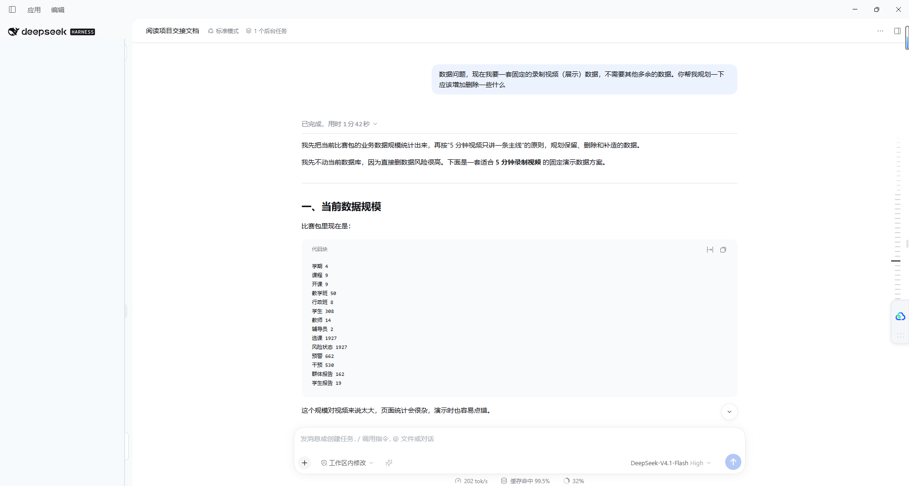
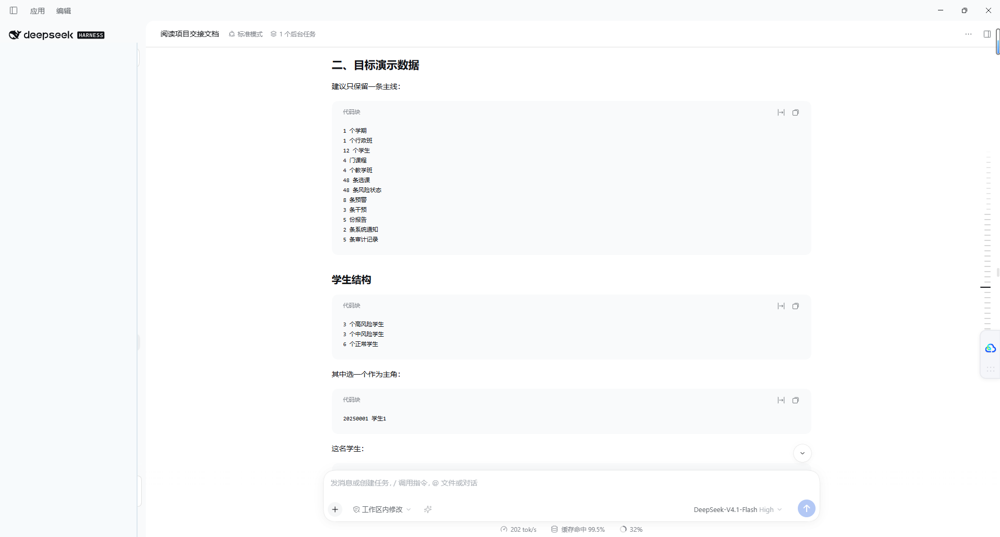
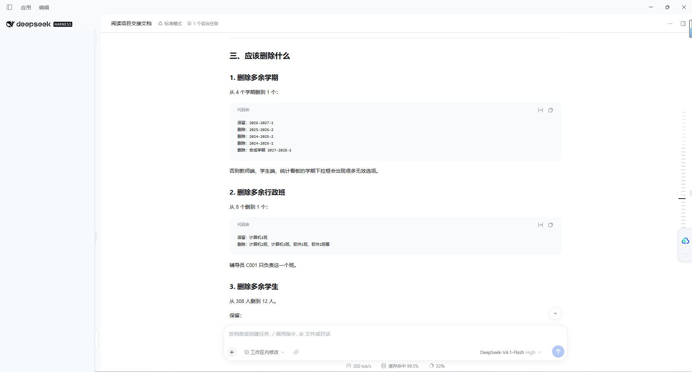
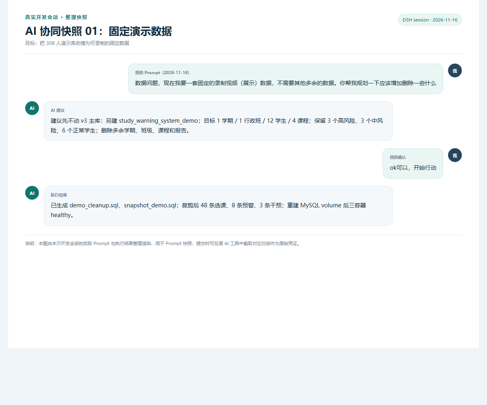

# 01 · 固定录制数据与可启动交付包

## 元信息

| 项 | 内容 |
|---|---|
| 时间 | 2026-11-16 |
| 目标 | 把 308 人 / 50 教学班的演示库收缩为可录制、可复现的固定数据 |
| AI 工具 | DeepSeek Harness（开发 Agent） |
| 产物 | `study_warning_system_demo`、`snapshot_demo.sql`、`docker-compose.demo.yml` |
| 验证 | 三容器 healthy；四端登录；P1 `PASS=14 FAIL=0` |

## 原始 DSH 截图







> 截图来源：DeepSeek Harness 桌面界面，2026-11-16。三张分别记录原始 Prompt、目标演示数据方案和删除/保留清单。

## 快照图片



> 这是按真实会话 Prompt 与执行结果整理的快照图；若官网要求原始工具界面，请用同一 Prompt 在 AI 工具中补一张原生截图。

## Prompt 1：先规划，不直接删库

**用户 Prompt：**

> 数据问题，现在我要一套固定的录制视频（展示）数据，不需要其他多余的数据。你帮我规划一下应该增加删除一些什么

**AI 建议：**

- 先统计现有数据规模；
- 不直接改 v3 主库，另建 `study_warning_system_demo`；
- 目标收缩为 1 学期 / 1 行政班 / 12 学生 / 4 课程；
- 删除多余学期、班级、学生、课程、报告；
- 保留 3 个高风险、3 个中风险、6 个正常学生；
- 为录制准备 3 条干预、2 条通知、4 份报告。

**人工确认：**

> ok可以，开始行动

## Prompt 2：执行裁剪

**用户 Prompt（继续指令）：**

> 先运行前后端检查网页确保交付包运行后看到的是新数据。交付包默认没有 AI Key，把我们代码中目前的ai key写进去不行吗。报告结构和 Prompt 文本已经演进，但代码里的版本号没有同步 bump 到 v2。为什么不同步。verify_p1.ps1 需要 MySQL 和运行中的后端那你就做啊。

**AI 执行与修正：**

1. 克隆 v3 库到 demo 库；
2. 生成 `demo_cleanup.sql`；
3. 保留学生 ID：`1,1001,1002,1004,1006,1008,1012,1014,1018,1019,1020,1022`；
4. 保留教学班：`201–204`；
5. 保留课程：`大学计算机基础（一）/ 高等数学（一）/ 四史概述 / 数据结构（Java）`；
6. 预警从 21 条裁到 8 条，干预从 27 条裁到 3 条；
7. 生成 `snapshot_demo.sql`，重建 MySQL volume 验证。

## 遇到的问题与修复

### 问题 1：旧快照缺 `ai_run_step`

第一次启动交付包，教学班报告返回 500：

```text
ai_run_step 表不存在
```

**修复：**

- 从当前数据库重新生成 `snapshot_v3.sql`；
- 确认包含 `ai_run_step`；
- 重建 MySQL volume 并重新验证。

### 问题 2：预警/干预数量仍偏多

裁剪后：

```text
预警 21
干预 27
```

**修复：**

- 只保留 8 条预警、3 条干预；
- 让干预覆盖有效、无效、已上报三种状态。

## 最终结果

```text
学期 1
行政班 1
学生 12
教师 1
辅导员 1
课程 4
教学班 4
选课 48
风险状态 48
预警 8
干预 3
报告 4
通知 2
```

## 证据

- `v3.0/sql/seeds/demo_cleanup.sql`
- `v3.0/sql/seeds/demo_notices.sql`
- `v3.0/sql/snapshot_demo.sql`
- `v3.0/docker-compose.demo.yml`

## 原始截图核验建议

快照图已附在上方。提交前如需“原始工具界面”凭证，建议补一张同 Prompt 的 AI 工具原生截图，重点露出工具名称、Prompt 和返回结果。
