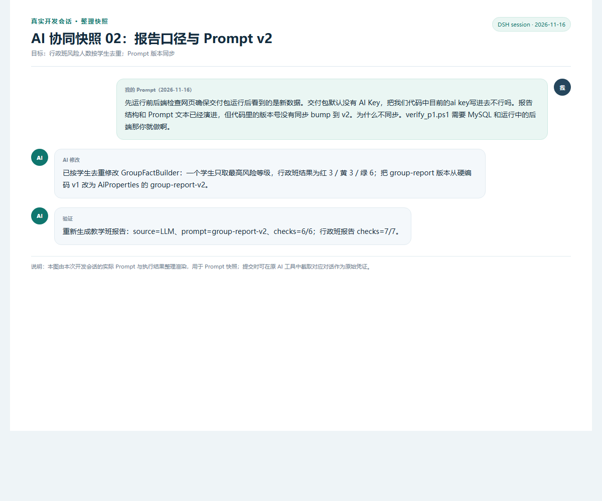
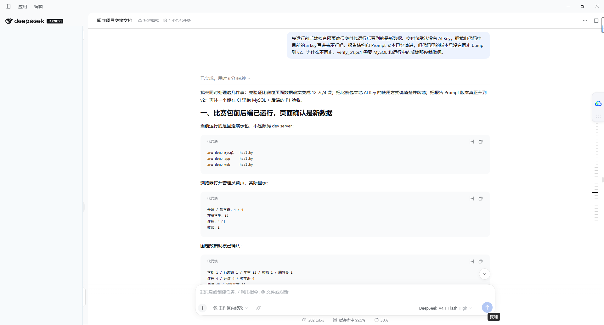
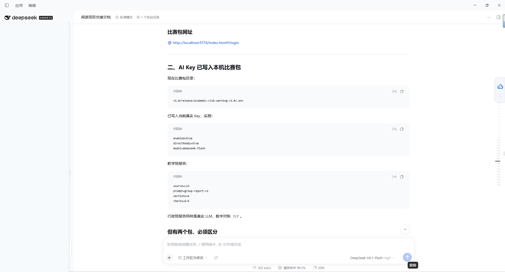
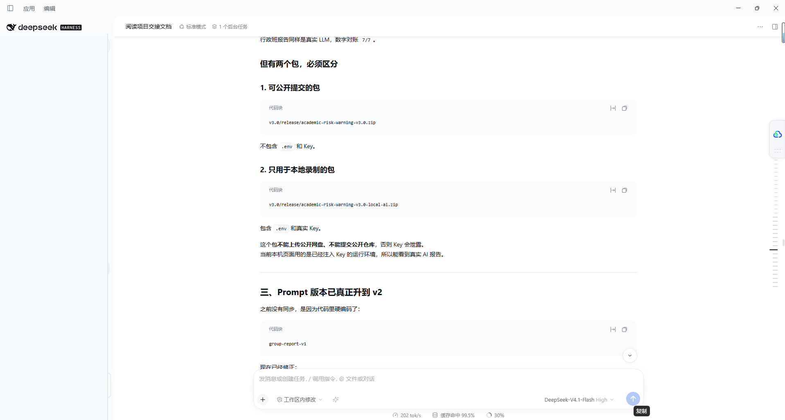

# 02 · 行政班报告数字口径与 Prompt v2

## 元信息

| 项 | 内容 |
|---|---|
| 时间 | 2026-11-15 至 2026-11-16 |
| 目标 | 修正行政班报告人数口径；让 Prompt 版本与结构变更一致 |
| AI 工具 | DeepSeek Harness（开发 Agent） |
| 产物 | `GroupFactBuilder.java`、`AiProperties.java`、`GroupReportService.java` |
| 验证 | 红灯 3 人 / 黄灯 3 人 / 绿灯 6 人；`checks=7/7`；`prompt=group-report-v2` |

## 快照图片



> 这是按真实会话 Prompt 与执行结果整理的快照图；若官网要求原始工具界面，请用同一 Prompt 在 AI 工具中补一张原生截图。

## 原始 DSH 截图

以下三张是用户在 DeepSeek Harness 中提供的原始界面截图，记录同一轮会话的 Prompt、AI Key 验证、报告结果、交付包区分和 Prompt v2 修正。它们主要对应本组“报告口径 / 版本 / 交付包”迭代：







> 截图来源：DeepSeek Harness 桌面界面，2026-11-16。原始文件同时保存在交付材料的 `02_AI对话Prompt快照/images/raw/02-report/`。

## Prompt 1：报告数字对不上

**用户 Prompt：**

> 数据问题，现在我要一套固定的录制视频（展示）数据，不需要其他多余的数据。你帮我规划一下应该增加删除一些什么

在规划过程中，AI 发现行政班报告的风险人数按“选课记录”统计，和“一个班 12 人”的人头口径不一致。用户确认方案后，进入修正。

**AI 建议：**

- 行政班是“一个学生 × 多门课”，红灯/黄灯/绿灯必须按学生去重；
- 一个学生多门课有风险时，只按最高等级计一次；
- 课程级风险仍可按选课记录统计，但文案要区分“人”和“人次”。

## Prompt 2：要求真正修代码

**用户 Prompt：**

> 先运行前后端检查网页确保交付包运行后看到的是新数据。交付包默认没有 AI Key，把我们代码中目前的ai key写进去不行吗。报告结构和 Prompt 文本已经演进，但代码里的版本号没有同步 bump 到 v2。为什么不同步。verify_p1.ps1 需要 MySQL 和运行中的后端那你就做啊。

**AI 修改：**

### 修改 1：按学生去重

`GroupFactBuilder.buildAdminClass` 增加按学生分组的风险聚合：

```sql
select sum(case when has_red = 1 then 1 else 0 end) as red,
       sum(case when has_red = 0 and has_yellow = 1 then 1 else 0 end) as yellow,
       sum(case when has_red = 0 and has_yellow = 0 and has_green = 1 then 1 else 0 end) as green
from (
    select s.id,
           max(case when rs.risk_level = 'RED' then 1 else 0 end) as has_red,
           max(case when rs.risk_level = 'YELLOW' then 1 else 0 end) as has_yellow,
           max(case when rs.risk_level = 'GREEN' then 1 else 0 end) as has_green
    from enrollment e
             join student s on s.id = e.student_id
             join term t on t.id = e.term_id and t.is_current = 1
             left join risk_state rs on rs.enrollment_id = e.id and rs.is_void = 0
    where s.admin_class_id = ?
    group by s.id
) x
```

### 修改 2：Prompt 版本从硬编码改为配置

修改前：

```java
ps.setString(i++, "group-report-v1");
```

修改后：

```java
ps.setString(i++, props.getGroupReportPromptVersion());
```

`AiProperties` 新增：

```java
private String groupReportPromptVersion = "group-report-v2";
```

## 遇到的问题与修复

### 问题：只是改了 Prompt 文本，版本号没变

**原因：**

- 早期报告版本号写死在 `GroupReportService.persist`；
- 报告结构扩展后，只改了 Prompt 文本，没有同步版本字段；
- 导致 `ai_group_report.prompt_version` 与文档不一致。

**修复：**

- 把版本提到 `AiProperties`；
- 后续 Prompt 变更必须 bump；
- 重新生成报告，验证返回值 `prompt=group-report-v2`。

## 最终结果

行政班报告：

```text
共 12 人
红灯 3 人
黄灯 3 人
绿灯 6 人
checks=7/7
prompt=group-report-v2
```

教学班报告：

```text
source=LLM
model=deepseek-flash
prompt=group-report-v2
checks=6/6
```

## 证据

- `v2.0/backend/src/main/java/.../GroupFactBuilder.java`
- `v2.0/backend/src/main/java/.../AiProperties.java`
- `v2.0/backend/src/main/java/.../GroupReportService.java`
- `v3.0/docs/prompt-history.md`

## 原始截图核验建议

快照图已附在上方。提交前如需“原始工具界面”凭证，建议补一张同 Prompt 的 AI 工具原生截图，重点露出工具名称、Prompt、代码 diff 和报告验证结果。
