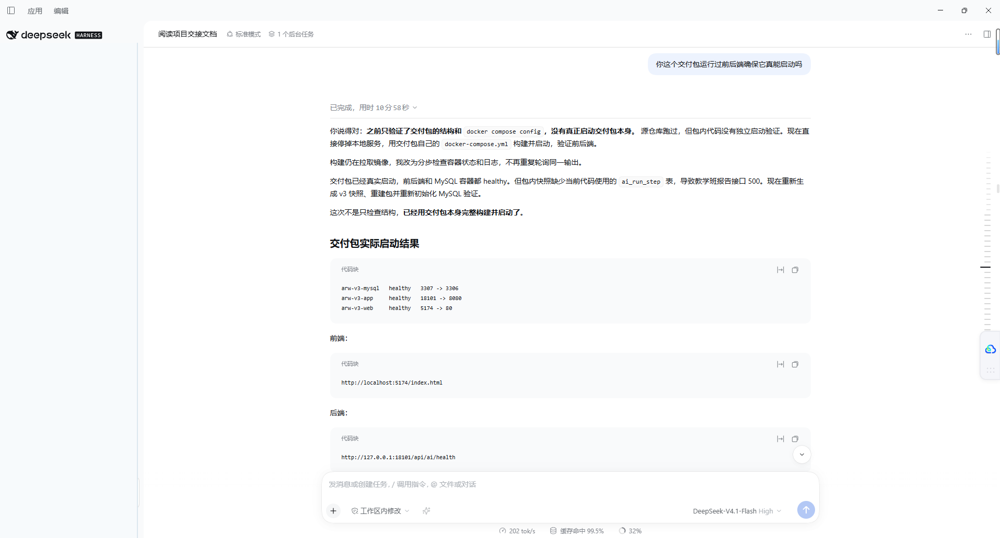
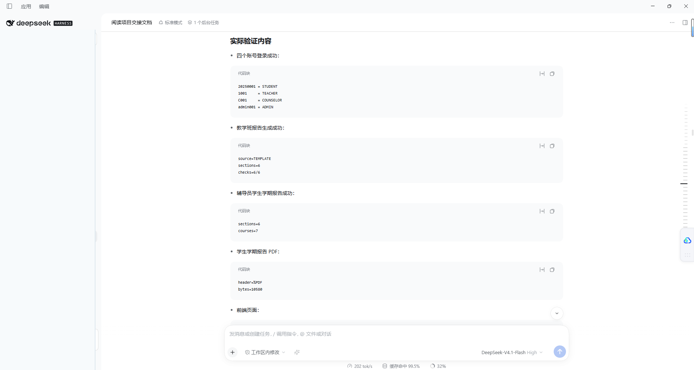
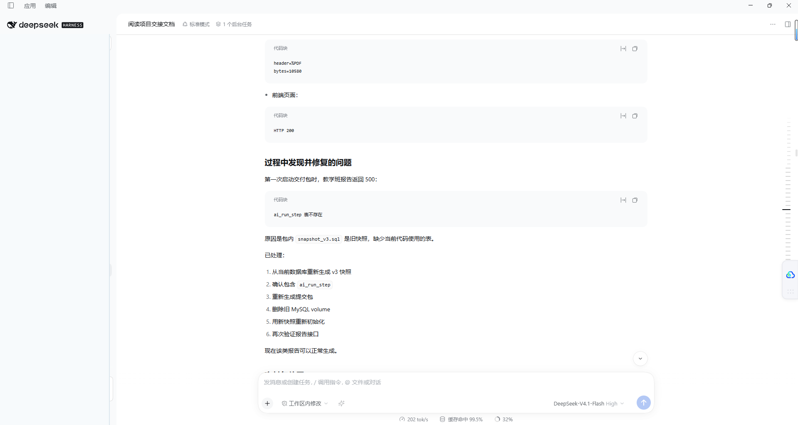

# 03 · 交付包真实启动验证

## 元信息

| 项 | 内容 |
|---|---|
| 时间 | 2026-11-16 |
| 目标 | 不用源码目录，实际构建并启动比赛交付包，确认前后端和数据库可用 |
| AI 工具 | DeepSeek Harness（开发 Agent） |
| 产物 | 三容器 healthy、四端登录、报告生成 |
| 验证 | MySQL / 后端 / 前端均 healthy；报告可生成；`ai_run_step` 缺失问题已修复 |

## 原始 DSH 截图







> 截图来源：DeepSeek Harness 桌面界面，2026-11-16。三张覆盖原始 Prompt、实际验证结果和 `ai_run_step` 修复过程。

## Prompt：先验证，不先声称

**用户 Prompt：**

> 你这个交付包运行过前后端确保它真能启动吗

**AI 处理：**

- 承认此前只验证了包结构和 `docker compose config`；
- 停止本地源码服务，改用交付包自己的 compose；
- 实际构建并启动 MySQL / 后端 / 前端；
- 检查容器健康状态；
- 发现教学班报告 500：包内快照缺 `ai_run_step` 表；
- 重新生成 v3 快照、重建 MySQL volume、再次验证。

## 最终结果

```text
arw-v3-mysql  healthy
arw-v3-app    healthy
arw-v3-web    healthy
```

四端登录成功：

```text
20250001 = STUDENT
1001     = TEACHER
C001     = COUNSELOR
admin001 = ADMIN
```

报告：

```text
教学班报告 sections=6 checks=6/6
学生学期报告 sections=6 courses=7
PDF header=%PDF
前端 HTTP 200
```

## 证据

- `v3.0/release/academic-risk-warning-v3.0/docker-compose.yml`
- 三容器状态
- `ai_run_step` 修复记录

## 说明

这是“交付包真实运行”迭代；P1 验收进入 CI 的迭代见 [04-ci-integration.md](04-ci-integration.md)。
