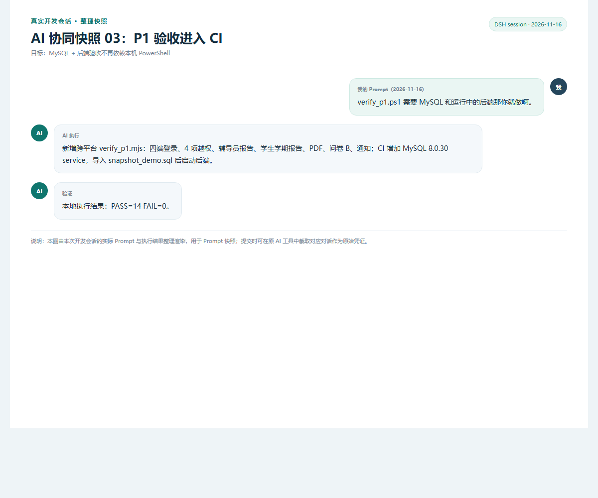

# 04 · P1 集成验收进入 CI（补充案例）

## 元信息

| 项 | 内容 |
|---|---|
| 时间 | 2026-11-16 |
| 目标 | 让 `verify_p1.ps1` 的 MySQL + 运行中后端验收进入 GitHub Actions |
| AI 工具 | DeepSeek Harness（开发 Agent） |
| 产物 | `v3.0/tool/verify_p1.mjs`、`.github/workflows/ci.yml` |
| 验证 | 本地 `PASS=14 FAIL=0`；CI 配置已提交 |

## 快照图片



> 这是按真实会话 Prompt 与执行结果整理的快照图；本组作为补充案例，原始界面尚未单独截图。

## Prompt 1：为什么 CI 没跑完整验收

**用户 Prompt：**

> 先运行前后端检查网页确保交付包运行后看到的是新数据。交付包默认没有 AI Key，把我们代码中目前的ai key写进去不行吗。报告结构和 Prompt 文本已经演进，但代码里的版本号没有同步 bump 到 v2。为什么不同步。verify_p1.ps1 需要 MySQL 和运行中的后端那你就做啊。

**AI 判断：**

- 原 `verify_p1.ps1` 依赖 Windows PowerShell、MySQL 和已启动后端；
- GitHub Actions 的 `backend` job 只跑编译和单测；
- 需要补一个可跨平台的验收脚本和一个 `p1-integration` job。

## Prompt 2：执行

**AI 修改：**

1. 新增 `v3.0/tool/verify_p1.mjs`：
   - 四端登录；
   - 越权拦截；
   - 辅导员读取本人行政班报告；
   - 学生学期报告生成；
   - PDF 文件头校验；
   - 问卷方案 B；
   - 系统通知。
2. 修改 `.github/workflows/ci.yml`：
   - 增加 MySQL 8.0.30 service；
   - 导入 `snapshot_demo.sql`；
   - 启动后端 `bootRun`；
   - 执行 Node 验收。

## 遇到的问题与修复

### 问题 1：PowerShell 不能直接跑在 Linux runner

**修复：**

- 保留原 `verify_p1.ps1` 给本地；
- 新增不依赖 PowerShell 的 `verify_p1.mjs`。

### 问题 2：CI 数据库是空的

**修复：**

- 在 job 中先建立 `study_warning_system_demo`；
- 导入固定快照 `snapshot_demo.sql`；
- 再启动后端。

### 问题 3：验证码调试

**修复：**

- CI 启动参数显式传：

```text
--app.auth.captcha-debug=true
```

## 最终结果

本地：

```text
[PASS] 后端健康检查
[PASS] 登录 20250001 / 1001 / C001 / admin001
[PASS] 越权拦截 4 项
[PASS] 辅导员读取本人行政班报告
[PASS] 学生学期报告生成
[PASS] 学生学期报告 PDF
[PASS] 问卷方案 B
[PASS] 系统通知

结果：PASS=14 FAIL=0
```

## 证据

- `v3.0/tool/verify_p1.mjs`
- `.github/workflows/ci.yml`
- 本地运行输出

## 原始截图核验建议

快照图已附在上方。提交前如需“原始工具界面”凭证，建议补一张同 Prompt 的 AI 工具原生截图，重点露出 Prompt、CI 配置和 `PASS=14 FAIL=0`。
