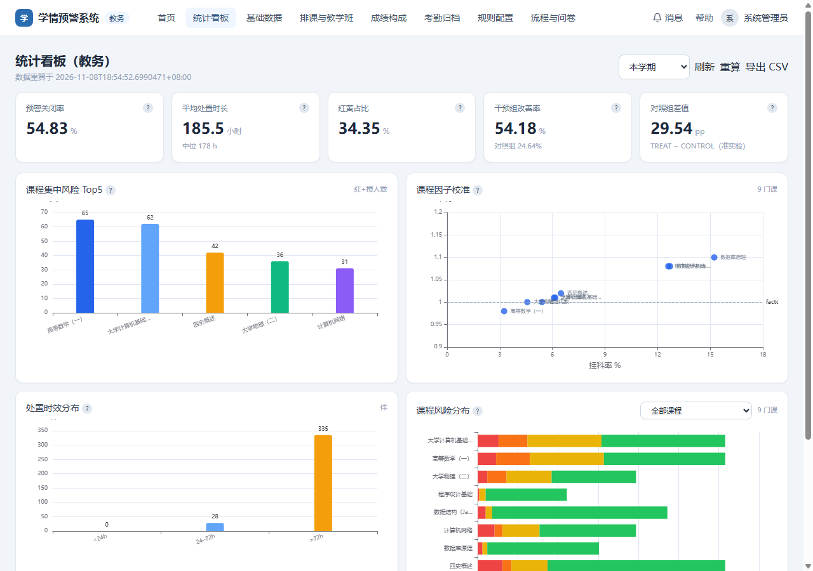
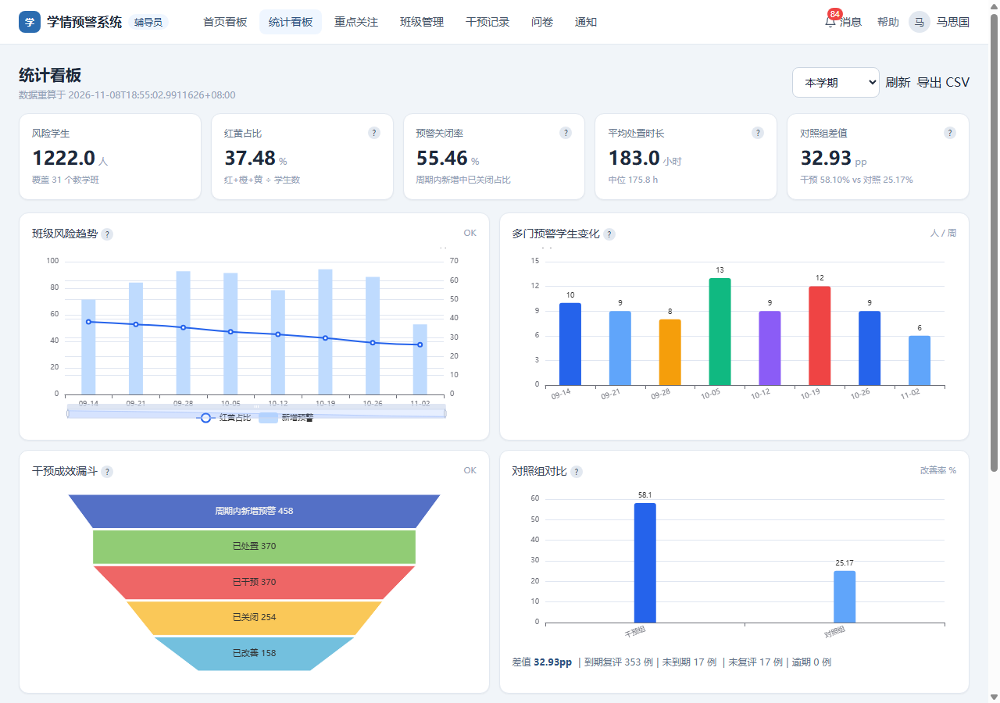

# v3.0 P1 证据卡（统计模块）

> 结论：P1-1 ~ P1-9 全部完成（含隐藏前置 P1-0），`ci.ps1` **6/6 步 PASS**，统计对账 **11/11 PASS**。
> 数据基于 v3.0 独立库 `study_warning_system_v3`（v2.0 演示库未改动）。

## 1. 五指标实测（termId=5，period=term）

| 指标 | 口径 | 实测 |
|---|---|---|
| 预警关闭率 | 周期内新增且已关闭 ÷ 周期内新增 | **54.83%**（363 / 662） |
| 平均处置时长 | 已关闭预警 close−create 均值 | **185.2 小时** |
| 干预后等级下降比例 | T+7（7–14 天）复评等级下降 ÷ 有效复评 | **干预组 54.18%**（162 / 299 due） |
| 7 天复评改善率 | 到期干预中改善 ÷ 到期 | 214 / 510 = **41.96%** |
| 风险面变化率 | 红黄占比，本周 vs 上周 | **34.35%**，较上周 **−6.08pp** |
| 对照组（可归因） | TREAT − CONTROL 改善率 | **54.18% vs 24.64% = 29.54pp** |

补充：平均风险分 29.14；风险分布 RED 141 / ORANGE 138 / YELLOW 383 / GREEN 1265（1927 人、50 个教学班）。

## 2. 看板截图

### 教务端 `/admin/stats`



### 辅导员端 `/counselor/stats`（C001，1222 人 / 31 个教学班）



- 教务 5 图：关闭率/处置时长/红黄占比/干预改善率 KPI、课程集中风险 Top5、课程因子校准散点、处置时效分档、课程风险分布；附 AI 质量卡占位（P2 接入）。
- 辅导员 5 图：班级风险趋势（红黄占比 + 新增预警）、多门预警学生变化、成效漏斗、TREAT/CONTROL 对照组、班级风险堆叠对比。
- 每图带「?」口径气泡（定义 + SQL）；支持 学期/月/周 切换、刷新、CSV 导出；教务另有「重算」按钮。

## 3. 数据底座（P1-0 / P1-2 / P1-3）

| 项 | 实测 |
|---|---|
| 告警生命周期 | 662 条：ACTIVE 132 / HANDLING 167 / CLOSED 363；时间分散在 2026-09-15 ~ 2026-11-05 |
| 时间线 | alert_flow_log 2,747 条（CREATED/NOTIFIED/ACKNOWLEDGED/HANDLED/CLOSED） |
| 干预与对照组 | TREAT 316 / CONTROL 214；level_before/level_after/cohort 落库；T+7 复评 510 例 due |
| 日快照 | stat_daily_class 450 行（9 周 × 50 班，回填演示历史） |
| 周 KPI | stat_weekly_kpi 36 行（9 周 × 4 指标，scope=ALL） |
| 干预成效 | stat_intervention_effect 328 行（周 × 教学班 × cohort） |
| 失效机制 | 手工置 500 行 `is_stale=1` → 读 overview 自动重算回 0，返回 `stale=false` |

> 说明：P1-0 数据为**演示构造**（准实验、非净效应）；`stat_daily_class` 历史为回填值，用于把趋势/对照组讲清楚；`course_factor` 为 P0-2 真实初始化结果（0.90–1.15）。

## 4. 接口与导出（P1-4 / P1-7 / P1-8）

- `/api/stats` 七接口：overview / trend / distribution / compare / funnel / effect / export（CSV + XLSX）。
- 统一响应 `StatsEnvelope`：`current / previous / deltaRate / dataStatus / reason / sampleSize / asOf / stale / engineVersion / materializedAt / period`。
- 鉴权：`COUNSELOR` 本班、`ADMIN` 全校；无 token 401、学生 403。
- 导出：CSV 与接口数字一致；XLSX 为 POI 生成（PK 头，~3.9KB 总览）。
- 对账脚本 `verify_stats.ps1`：**11/11 PASS**（含 overview/closeRate/distribution/compare/funnel/effect/trend/export/401-403/辅导员范围）。

## 5. 复现命令

```powershell
# 1) 重建 v3 库（含 40/41/50/51 SQL）
powershell -NoProfile -ExecutionPolicy Bypass -File v3.0/tool/bootstrap_v3.ps1
# 2) 全链路：seed → 判定 → P1-0 生命周期 → 物化 → 报告 → 快照 → 基线
powershell -NoProfile -ExecutionPolicy Bypass -File v3.0/tool/run_v3_pipeline.ps1
# 3) 统计对账（自带后端，18085）
powershell -NoProfile -ExecutionPolicy Bypass -File v3.0/tool/verify_stats.ps1
# 4) 一键 CI（编译→单测→数据校验→报告对账→基线→统计对账）
powershell -NoProfile -ExecutionPolicy Bypass -File v3.0/tool/ci.ps1
# 5) 前端构建（看板）
cd v2.0/frontend; npm run build
```

## 6. 验收对照

| 清单项 | 验收点 | 证据 |
|---|---|---|
| P1-1 | 每指标主/辅口径 + SQL | `v3.0/docs/metrics.md` |
| P1-2 | 三表含 engine_version/source_max_update_time/is_stale | `v3.0/sql/50_stats_ddl.sql` + `51_p1_intervention_review.sql` |
| P1-3 | 改判定后重算生效；显示「数据重算于…」 | `StatsMaterializer` + stale 500→0；看板页头显示 materializedAt |
| P1-4 | 七接口统一 current/previous/deltaRate | `StatsController` + `StatsEnvelope`；verify_stats 11 项 |
| P1-5 | 辅导员 5 图 + 对照组差值 | 截图 `counselor_stats.png`；diff 32.93pp（C001 范围） |
| P1-6 | 教务 5 图 + 校准散点 | 截图 `admin_stats.png`；9 门课散点 |
| P1-7 | 每图口径气泡 + 导出数字一致 | `InfoTooltip.vue`；CSV/XLSX 与接口一致 |
| P1-8 | 图表↔SQL 逐一比对 | `verify_stats.ps1` 11/11；`ci.ps1` 第 6 步 |
| P1-9 | 看板截图 + 复现命令 + 对照组差值 | 本文件 + `screenshots/` |

## 7. 已知限制 / 风险

1. **演示数据边界**：P1-0 的关闭/干预/T+7 复评与对照组均为构造数据，答辩需标注「准实验、非净效应」。
2. **单学期假设**：三张 stat 表未带 `term_id`，当前只服务 term=5；多学期需加列/迁移（P1-2 遗留项）。
3. **周 KPI 仅 scope=ALL**：未按辅导员/班级拆周 KPI；看板对比走实时/日快照。
4. **图表交互有限**：未引入 ECharts（本机 npm 源不可用），自研 SVG 仅 hover 提示，无缩放/图例筛选；P1-7 的「可点开定义与 SQL」已由气泡实现。
5. **AI 质量卡占位**：v3 当前无 Agent 运行数据，等 P2 完成后再接。
6. **旧接口保留**：`/api/{admin,counselor}/metrics/intervention` 未下线（D3），不影响新看板。
7. **HANDOFF 中 P1-3 的「previous」口径**：取上一自然周最后一条日快照；跨周班级新增/撤销未做交集对齐（当前 50 班稳定，无影响）。

## 8. P1 硬化（限制 1–9、12）

| # | 限制 | 修复 | 验证 |
|---|---|---|---|
| 1 | 演示数据真实性 | 新增 `docs/data_authenticity.md`（构造方法/边界/引用要求）；新增置换检验 `tool/placebo/PlaceboTest.java` + `run_placebo.ps1` → `eval/placebo.json` | TREAT 54.18% vs CONTROL 24.64%，观测差 29.54pp；零分布 95% [−8.46, 8.52]，置换 p≈0.0002（5000 次） |
| 2 | stat 表无 term_id | `52_stats_term_id.sql`：三表加 `term_id`、唯一键含学期；Materializer/Repository 全按 term 读写；bootstrap 应用 50/51/52/53 | `null term rows=0`；唯一键 `uk_term_*` 存在；verify_stats 通过 |
| 3 | 周 KPI 仅 ALL | Materializer 分 scope 写 `ALL / COUNSELOR / CLASS`（COURSE 无日快照数据，暂缓） | `scope types=3`；KPI 行 1,211（term=5） |
| 4 | 学生级/班级级口径不一致 | 统一为**教学班口径**：Scope 增加 `teachingClassIds`（enrollment→student→counselor_class 映射）；Repository 全部按 `teaching_class_id` 过滤 | C001 学生级=班级级=1222（31 个班，与 C002 零重叠）；verify 辅导员裁剪 PASS |
| 5 | 辅助口径缺失 | 补中位处置时长（窗口函数）、逾期/未复评数、课程/班级风险占比；接口与看板展示 | `median=178h`、`overdue=0/notReviewed=20`；verify 通过 |
| 6 | export 覆盖不全 | CSV/XLSX 均支持 overview/distribution/compare/funnel/effect；verify 校验 5 类 CSV 表头 + XLSX `sharedStrings` 内容 | 5 类 CSV 表头齐、effect.xlsx 含 TREAT/CONTROL；verify 通过 |
| 7 | 趋势仅周五点 | P1-0 改为逐日回填（62 天 × 50 班 = 3,100 行），新增 `source` 列区分 `DEMO_BACKFILL`/`MATERIALIZED` | `distinct dates=62`、`source kinds=2`；verify 通过 |
| 8 | stale 语义被掩盖 | Envelope 增加 `staleBefore / refreshed / refreshReason`；看板显示“因 xxx 已自动重算” | verify 检查字段存在；stale 测试可复现 |
| 9 | 前端图表弱 | 离线 vendor ECharts（ESM 1.03MB），5 图支持缩放/图例/tooltip/点击；看板加班级/课程筛选与点击明细 | `npm run build` 通过；截图见 `screenshots/`（趋势缩放条、漏斗、散点、堆叠、点击筛选） |
| 12 | 性能未验证 | `53_stats_source_indexes.sql` 补 `alert_record/intervention_record` 复合索引；多门预警改单查询；verify 逐接口计时 | 接口时延 26–54ms（远低于 2s）；索引检查通过 |

> 尚未处理（按约定排除）：限制 10（AI 质量卡，P2 接入）、限制 11（旧干预接口下线）。
