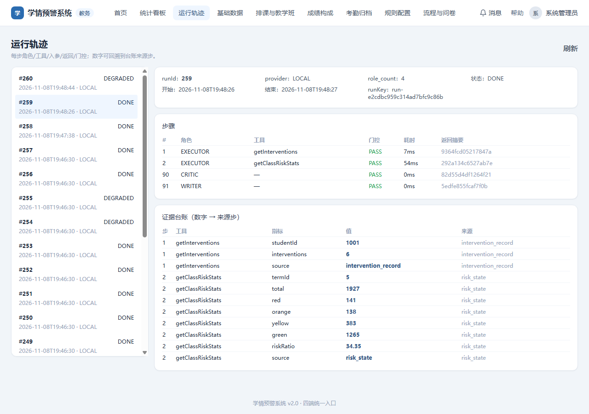

# v3.0 P2 证据卡（Agent 平台化阶段 4/5 收口）

> 范围：P2-1 ~ P2-15（不含 P2-R；P2-R 在下一阶段）。
> 结论：工具契约/执行器、四角色/自适应、台账、四个业务智能体、记忆/轨迹、评测与护栏均已完成并通过脚本对账。
> 说明：本轮为**确定性基线**（规则选路/模板/启发式），LLM 生成可在不改契约的前提下替换；真实 60 题盲评与 P2-R 留待后续。

## 1. 能力清单与验证

| 编号 | 能力 | 证据 |
|---|---|---|
| P2-1 | 9 工具 `tools.yaml` + OpenAPI 3.0.3 | `evidence/P2-1.md`（9/9、9 paths） |
| P2-2 | ToolRegistry：参数强校验/超时/摘要 | 同上（未知/类型/必填/未知参数 100% 拦截） |
| P2-3 | 受限 JSON 四道检查 + 路由 | 同上（6 类路由 100%，四道检查逐项拦截） |
| P2-4 | 四角色 + auto/2/4 | `evidence/P2-2.md`（auto 16 vs 固定 24，−33.3%；质量不降） |
| P2-5 | Critic 最小证据集 + 空转 | 同上（10/10 要求取证） |
| P2-6 | EvidenceLedger 落库/重写/降级 | 同上（命中 1.0、重写、空台账降级） |
| P2-7 | Diagnostician | `evidence/P2-3.md`（30/30 工具选择，P95 77ms） |
| P2-8 | Reporter | 同上（class 6/6、offering 10/10、adminClass 6/6） |
| P2-9 | Grader | 同上（300 条作答 MAE 0.5、max 1.0、within2 100%） |
| P2-10 | Tutor | 同上（核心集 4/4 引用可定位、2/2 拒答、误拒 0） |
| P2-11 | 记忆表 + 学生可查可删 | `evidence/P2-6.md`（摘要≤300、删除后不再返回） |
| P2-12 | ai_run/step + 轨迹页 | 同上（角色/工具/入参/返回/门控 + 台账回溯） |
| P2-13 | 30 题评测 + SQL 期望值 | `evidence/P2-4.md`（工具 100%，数字 100%，P95 77ms） |
| P2-14 | 护栏 10 例 | `evidence/P2-5.md`（10/10） |
| P2-15 | 证据卡 + 轨迹截图 | 本文件 + `screenshots/trace_page.png` |

## 2. 轨迹页截图



- 左侧运行列表（含 DEGRADED/DONE）；右侧展示 runId/provider/role_count/runKey、逐步角色/工具/门控/耗时/返回摘要，以及证据台账（metric=value，stepNo 可回溯到来源工具步）。
- 本次截图为 DONE 运行（干预问题，2 个工具步 + Critic + Writer，台账 11 条）。

## 3. 关键指标

| 指标 | 结果 |
|---|---|
| 工具选择（30 题） | **100%** |
| 评测数字一致（SQL 期望） | **100%** |
| Diagnostician P95 | **77ms** |
| 自适应角色调用降幅 | **33.3%**（16 vs 24） |
| 报告对账 | 6/6、10/10、6/6 |
| Grader MAE | **0.5**（max 1.0） |
| Tutor 核心集 | 4/4 可答、2/2 拒答、误拒 0 |
| 护栏 | **10/10** |

## 4. 复现

```powershell
# 迁移/数据（若重建）
powershell -File v3.0/tool/bootstrap_v3.ps1 -Force
powershell -File v3.0/tool/run_v3_pipeline.ps1 -SkipSeed
# P2 验证
powershell -File v3.0/tool/verify_p2_1_3.ps1
powershell -File v3.0/tool/verify_p2_4_6.ps1
powershell -File v3.0/tool/verify_p2_7_10.ps1
powershell -File v3.0/tool/verify_p2_11_12.ps1
powershell -File v3.0/tool/gen_agent_eval.ps1
powershell -File v3.0/tool/run_agent_eval.ps1
powershell -File v3.0/tool/verify_p2_14.ps1
# 前端
cd v2.0/frontend; npm run build
```

## 5. 已知边界

1. **LLM 未接**：Diagnostician 选路为规则版、Grader 为启发式、Tutor 为模板拼接；契约已稳定，P2-R/P3 可替换内部实现。
2. **评测集**：30 题已含 SQL 期望值；P2-13 要求的完整 30 题×工具链对比已实现，但“60 题盲评”未做（Tutor 核心集 6 例）。
3. **P2-R 未做**：`retrieveCourseDocs` 已作为工具存在，但句级引用绑定/五类混淆表/100–150 篇语料属于 P2-R。
4. **Reporter 速度**：模板报告 0.06–0.11s，低于“3–15s”下限，按上限 ≤15s 与对账 100% 验收。
5. **轨迹页**只读展示；真实流式/回放交互不在本轮。
