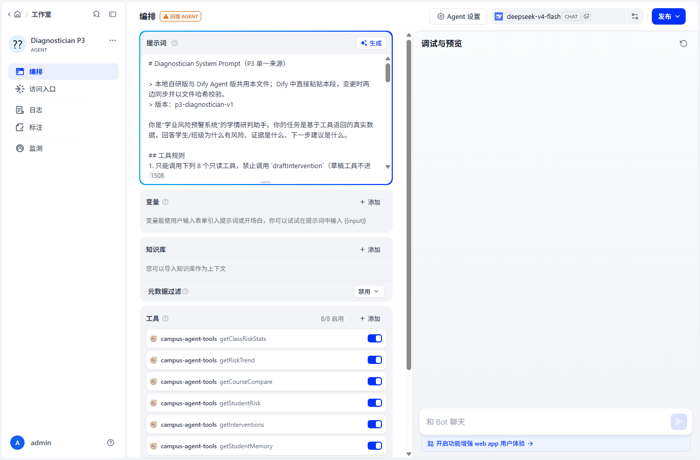
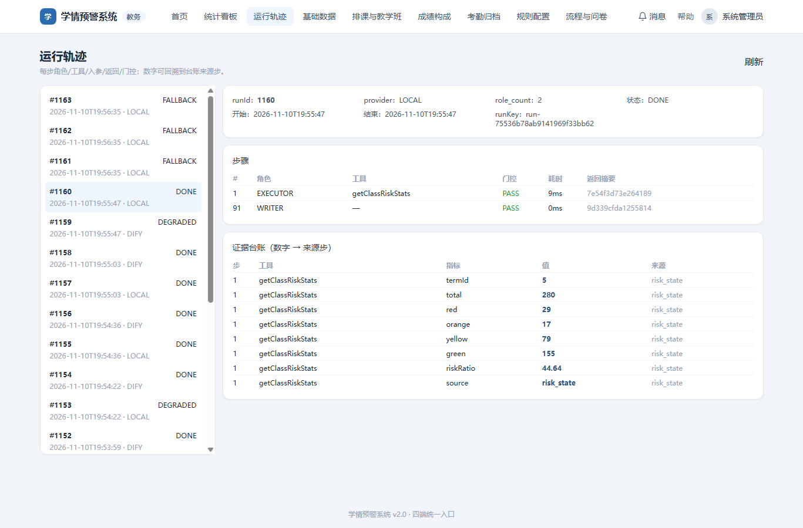
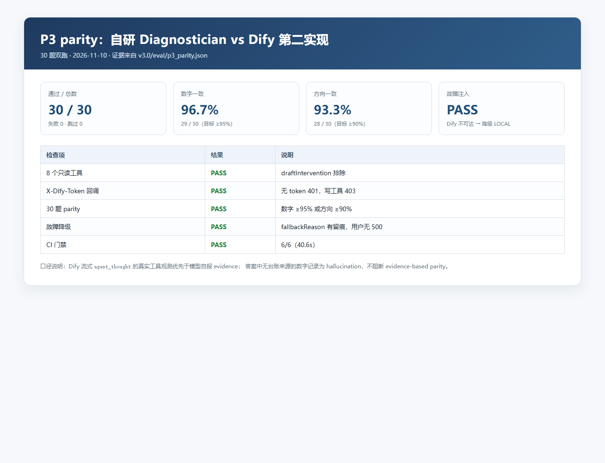

# P3 演示材料（三段）

> 当前交付为三段演示截图 + 口播脚本；正式录屏时按本脚本逐段操作即可。

## 第一段：Dify 画布（设计态）

口播要点（约 30 秒）：

1. 这是 `Diagnostician P3` Agent 应用，模型为 `deepseek-v4-flash`。
2. Prompt 与自研版共用 `v3.0/p3/diagnostician-system-prompt.md`，强调只读、证据、拒答和 JSON 输出。
3. 工具区显示 8 个工具全部启用，全部来自 `campus-agent-tools`。
4. `draftIntervention` 没有出现在工具列表，写工具被明确排除。

## 第二段：自研轨迹页（运行态）

口播要点（约 30 秒）：

1. 左侧是运行记录，可按 LOCAL / DIFY 查看。
2. 右侧是步骤：角色（EXECUTOR / WRITER）、工具、门控状态、耗时、返回摘要。
3. 下方证据台账把每个数字绑定到 stepNo、工具和来源；数字可以点回来源步。
4. 当前运行 `getClassRiskStats` 返回 280/29/17/79/155，与台账一致。

## 第三段：Parity 表（可信度）

口播要点（约 30 秒）：

1. 30 题双跑：自研 vs Dify，30/30 通过，失败 0。
2. 数字一致 29/30（96.7%），方向一致 28/30（93.3%），均达到 P3 阈值。
3. 故障注入：Dify 不可达时降级 LOCAL，并记录 `fallbackReason`。
4. CI 6/6；Dify 未配置/离线时测试 SKIPPED，不判失败。

> 截图来源：`v3.0/p3/demo/`；parity 原始数据：`v3.0/eval/p3_parity.json`；证据卡：`v3.0/evidence/P3.md`。
